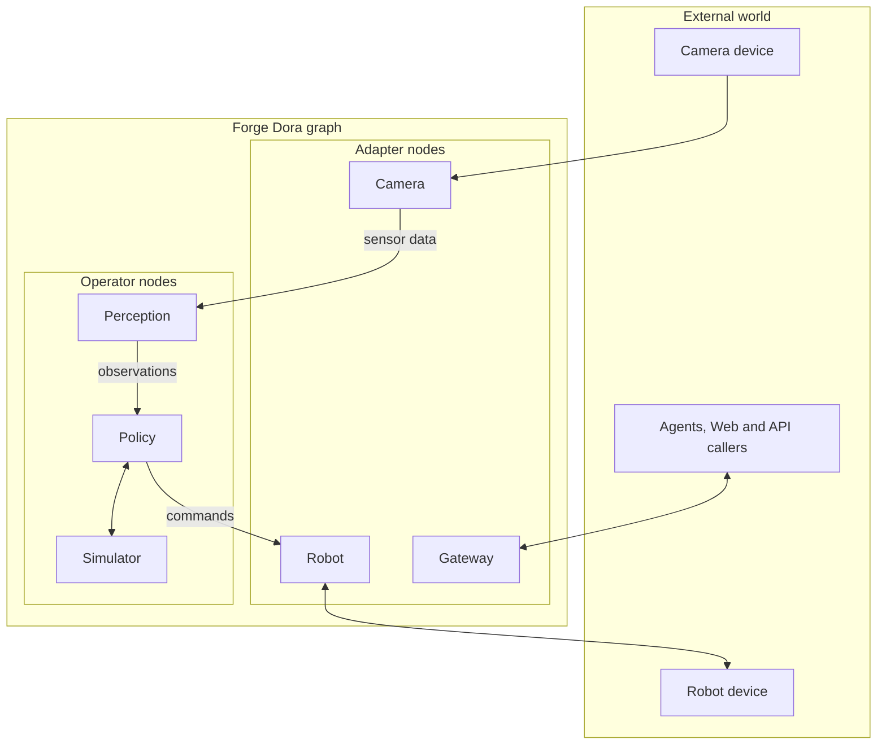

# Forge

[English](README.md) | [简体中文](README_zh.md)

Forge 是面向 Dora 数据流的机器人基础框架，提供公共消息 schema、Python/Rust 消息实现、
机器人驱动与策略节点可复用的运行器，以及类型化工具端点契约。

本仓库维护框架层能力：

- `interfaces/forge_msgs/`：权威消息 schema。
- `interfaces/forge_tool/`：Tool 文档索引、架构与语言无关的线协议。
- `interfaces/observability/`：可选发布/接收元数据协议与文档索引。
- `packages/msgs`：Python 消息模型与 Arrow 序列化。
- `crates/forge_msgs`：Rust 消息实现。
- `cpp/forge_msgs`：C++ 消息实现。
- `packages/robot`：机器人驱动接口、安全限幅辅助与标准 Dora Adapter 运行器。
- `cpp/forge_robot`：C++ 驱动接口、安全辅助及可选 Dora C++ Adapter 运行器。
- `packages/policy`：策略插件接口与标准 Dora Operator 运行器。
- `packages/tool`：无额外依赖的 ToolEndpoint SPI、逻辑消息模型及 Query/Action/Session 分发。
- `packages/common`、`crates/forge_common`：日志、追踪与可选发布/接收观测等公共工具。
- `packages/kinematics`：基于 Pinocchio 的可选 URDF 正运动学、几何 Jacobian 和确定性阻尼最小二乘逆运动学。

具体机器人驱动及硬件 SDK 集成放在下游包中，例如独立的 `forge_robots` 仓库。

## 版本状态

Forge 按 Common、Msgs、Robot、Policy、Kinematics、Tool 六个包家族维护。
Common 为 `2.1.0`，其余五家族保持 Dora 1.x 对齐的 `2.0.0` 基线。
各家族可独立发布次版本和修订版本；同一家族跨语言包版本保持一致，
实际能力允许不同，语言无关接口版本另行跟踪。

`master` 维护 Forge 2.x 开发线；`stable/1.x` 保留兼容 Dora 0.4 的 Forge 1.x，
用于下游迁移期间的关键修复。

发布采用受保护的家族标签，例如 `forge-msgs-v2.0.0`；Tool 使用 `forge-tool-v<semver>`。
历史通用标签（如 `v1.0.0`）属于旧目录结构，不能作为当前家族发布的标识。

家族初始发布确定消息 schema、序列化、公共工具、运动学及机器人/策略运行器的稳定契约。
每个家族当前主版本保持向后兼容；破坏契约时需升级该家族主版本。
发布基线见 [`CHANGELOG.md`](CHANGELOG.md)，家族边界、受保护标签和验证流程见
[`RELEASING.md`](RELEASING.md)。

Forge ToolEndpoint v1alpha1 是首个打标签公开的 Tool 契约，历史发布为 Tool `0.1.0`，
载体位于 Msgs `1.2.0`。部署须匹配 Gateway 与 provider 的源码版本。
更早的无标签原型不兼容，不保证混合部署的向后兼容性。

## Tool 文档

从 [`interfaces/forge_tool/README.md`](interfaces/forge_tool/README.md) 进入，
可跳转架构、规范性线协议、Python 包指南及权威 Arrow schema。

## Node 仓库文档要求

下游 Node 仓库必须在根 README 说明入口、Tool 支持、Endpoint ID、operation、直接 HTTP API 及部署 Tool 绑定。
生产 Node、Endpoint、operation 与 Gateway Tool 分开计数；不支持时写明 `0`，依赖配置时说明条件。
框架辅助库不计为已部署 Node。英文 `README.md` 与中文 `README_zh.md` 独立维护、顶部互链，
同一次接口修改必须同步两份。字段、模板与审阅要求见
[Node README 规范](CONTRIBUTING.md#node-readme-contract)。

## 可观测性文档

从 [`interfaces/observability/README.md`](interfaces/observability/README.md) 进入，
查看元数据协议与 Python 包指南。

## 仓库结构

```text
forge/
├── interfaces/forge_msgs/      # 跨语言权威消息 schema
├── interfaces/forge_tool/      # Tool 架构与线协议
├── interfaces/observability/   # 发布/接收元数据协议与校验
├── packages/common/            # Python 公共工具
├── packages/kinematics/        # Python Pinocchio 正/逆运动学与 Jacobian
├── packages/msgs/              # Python 消息模型与 Arrow 转换
├── packages/policy/            # Python 策略接口与 Dora 运行器
├── packages/robot/             # Python 机器人驱动接口与 Dora 运行器
├── packages/tool/              # Python ToolEndpoint 接口与逻辑协议
├── crates/forge_common/        # Rust 公共工具
├── crates/forge_msgs/          # Rust 消息类型与 Arrow 转换
├── cpp/forge_common/           # C++ 公共工具
├── cpp/forge_msgs/             # C++ 消息类型与 Arrow 转换
├── cpp/forge_robot/            # C++ 驱动辅助与 Dora 运行器
├── versions.toml               # 包家族发布版本
├── pyproject.toml              # Python uv 虚拟工作区
└── Cargo.toml                  # Rust Cargo 工作区
```

## 环境要求

- Python 3.12 或更新版本。
- 支持 edition 2024 的 Rust 工具链。
- C++ 包需要 C++20 编译器及 CMake 3.20 或更新版本；`cpp/forge_msgs` 及其依赖方要求 C++20。
- `cpp/forge_msgs` 需要 Apache Arrow C++。
- 可选 C++ `forge_robot` Dora 运行器需要 Rust 1.95 或更新版本及网络，或兼容的本地 Dora 1.x 源码。
- Python 依赖管理使用 [`uv`](https://docs.astral.sh/uv/)。
- 实际运行节点需要 Dora 1.x；Python 声明 `dora-rs>=1.0,<2`，当前锁文件采用 1.0.1。

## 安装

克隆仓库后安装默认 Python 工作区：

```bash
uv sync --dev
```

开发或运行完整 Python 测试集时，安装全部工作区包，包括 Tool 和可选 Pinocchio 运动学库：

```bash
uv sync --all-packages --all-extras --dev
```

构建 Rust 工作区：

```bash
cargo build --workspace
```

仅在 crates.io 包名所有权需要时，发行名与导入名有所不同：

| 家族 | PyPI 发行名 | crates.io 发行名 | 导入/库名 |
|---|---|---|---|
| Common | `forge-common` | `forgelab_common` | `forge_common` |
| Msgs | `forge-msgs` | `forge_msgs` | `forge_msgs` |

构建 C++ `forge_msgs`：

```bash
cmake -S cpp/forge_msgs -B cpp/forge_msgs/build
cmake --build cpp/forge_msgs/build
```

构建 C++ `forge_common`：

```bash
cmake -S cpp/forge_common -B cpp/forge_common/build
cmake --build cpp/forge_common/build
```

构建不含 Dora 运行器的 C++ `forge_robot`：

```bash
cmake -S cpp/forge_robot -B cpp/forge_robot/build
cmake --build cpp/forge_robot/build
```

按固定 Dora `v1.0.1` 基线构建并验证 C++ `forge_robot` 运行器的编译与链接：

```bash
cmake -S cpp/forge_robot -B cpp/forge_robot/build-dora \
  -DFORGE_ROBOT_CPP_WITH_DORA=ON \
  -DFORGE_ROBOT_CPP_BUILD_TESTS=ON
cmake --build cpp/forge_robot/build-dora --target forge_robot_dora_runner_compile
```

C++ Dora API 头文件由 Dora 的 CXX 桥生成。默认下载固定 SHA256 的 Dora `v1.0.1`
源码归档，不跟踪 Dora `main`。也可指定兼容的本地 Dora 1.x：

```bash
git clone --branch v1.0.1 https://github.com/dora-rs/dora.git /path/to/dora-v1.0.1
cmake -S cpp/forge_robot -B cpp/forge_robot/build-dora \
  -DFORGE_ROBOT_CPP_WITH_DORA=ON \
  -DDORA_ROOT_DIR=/path/to/dora-v1.0.1
cmake --build cpp/forge_robot/build-dora --target forge_robot_dora_runner_compile
```

在其他 CMake 项目中通过 Git 引用 C++ `forge_msgs`：

```cmake
include(FetchContent)

FetchContent_Declare(
  forge
  GIT_REPOSITORY https://github.com/PhyAgentOS/forge.git
  GIT_TAG forge-msgs-v2.0.0
  SOURCE_SUBDIR cpp/forge_msgs
)
FetchContent_MakeAvailable(forge)

target_link_libraries(my_app PRIVATE forge_msgs::forge_msgs)
```

C++ 消息库需要 Apache Arrow C++。若没有 `ArrowConfig.cmake`，
CMake 也可使用已安装 `pyarrow` 中的 Arrow 头文件与库。

在其他 CMake 项目中引用 C++ `forge_common`：

```cmake
include(FetchContent)

FetchContent_Declare(
  forge_common
  GIT_REPOSITORY https://github.com/PhyAgentOS/forge.git
  GIT_TAG forge-common-v2.1.0
  SOURCE_SUBDIR cpp/forge_common
)
FetchContent_MakeAvailable(forge_common)

target_link_libraries(my_app PRIVATE forge_common::forge_common)
```

`cpp/forge_common` 仅依赖 C++ 标准库，其日志工具与 Python 使用相同的
`FORGE_LOG_LEVEL`、`FORGE_LOG_FILE`、`FORGE_LOG_CONSOLE`、`FORGE_LOG_STREAM` 环境变量。

在其他 CMake 项目中引用 C++ `forge_robot`：

```cmake
include(FetchContent)

FetchContent_Declare(
  forge_robot
  GIT_REPOSITORY https://github.com/PhyAgentOS/forge.git
  GIT_TAG forge-robot-v2.0.0
  SOURCE_SUBDIR cpp/forge_robot
)
FetchContent_MakeAvailable(forge_robot)

target_link_libraries(my_robot_node PRIVATE forge_robot::forge_robot)
```

`cpp/forge_robot` 复用 `cpp/forge_msgs` 与 `cpp/forge_common`。
驱动接口、限幅与 Arrow 校验不依赖 Dora 头文件；
只有 `FORGE_ROBOT_CPP_WITH_DORA=ON` 时编译 `RunDoraRobotNode`。

下游 C++ 机器人包链接 `forge_robot::forge_robot`，并引入公共聚合头文件：

```cpp
#include <forge_robot/forge_robot.hpp>
```

仅实现驱动逻辑、安全限幅或 Arrow 校验时，保持 `FORGE_ROBOT_CPP_WITH_DORA` 关闭。
若需要编译 Dora 运行器，在配置时启用它；让 CMake 下载固定 `v1.0.1`，
或用 `DORA_ROOT_DIR` 指定兼容的 Dora 1.x 源码：

```bash
cmake -S . -B build \
  -DFORGE_ROBOT_CPP_WITH_DORA=ON \
  -DDORA_ROOT_DIR=/path/to/dora-v1.0.1
```

## 测试

核对 Python、Rust、C++ 实现与 `versions.toml` 的家族版本，
包括独立维护的 Msgs 接口版本和锁文件：

```bash
python scripts/check_release_versions.py
```

运行 Python 测试：

```bash
uv run pytest packages/msgs/tests packages/policy/tests packages/robot/tests packages/kinematics/tests packages/tool/tests
```

运行 Rust 测试：

```bash
cargo test --workspace --locked
```

创建 Git 标签前构建并检查发布归档：

```bash
uv run python scripts/build_python_distributions.py
cargo package --workspace --locked
```

默认 Python 构建脚本为六个包生成本地验证制品，从干净的 `dist/release/python` 开始，
检查 wheel/sdist 身份、Apache-2.0 元数据和许可证布局，执行额外运动学检查，
生成 `dist/release/python/SHA256SUMS`。全家族本地构建不等于发布。

从干净提交为单个家族构建发布候选：

```bash
uv run python scripts/build_python_distributions.py --release-family msgs
```

本地家族发布模式拒绝脏工作区，并要求预期受保护标签尚不存在。
家族标签 CI 自动选择该家族，并要求标签已存在且指向当前 `HEAD`。

运行 C++ 测试：

```bash
ctest --test-dir cpp/forge_msgs/build
ctest --test-dir cpp/forge_common/build
ctest --test-dir cpp/forge_robot/build
```

运行 Ruff 检查：

```bash
uv run ruff check .
```

## 消息 Schema

跨语言权威契约入口是 `interfaces/forge_msgs/forge_msgs.v1.yaml`，引用
`common.v1.yaml`、`control.v1.yaml`、`motion.v1.yaml`、`geometry.v1.yaml`、
`interaction.v1.yaml`、`perception.v1.yaml`、`sensor.v1.yaml`、`tool.v1.yaml`。
Python、Rust、C++ 实现应遵循这些定义；消息语义和 Arrow 编码见
`interfaces/forge_msgs/SCHEMA.md` 与 `packages/msgs/README.md`。

核心消息包括：

- `JointState`：机器人或仿真器关节观测。
- `JointCommand`：底层关节命令。
- `LocomotionCommand`：本体坐标系平面速度命令。
- `Image`、`CompressedImage`：相机载荷。
- `PointCloud`：规范化有序/无序 XYZ 数据。
- `PointCloudBuffer`：保留布局、支持动态定宽字段的解码点记录。
- `Imu`：SI 单位的姿态、角速度、线加速度样本。
- 二维/三维检测与实例掩码。
- `Pose`、`PolicyCommand` 及策略状态/控制消息。
- `ToolMessage`：ToolEndpoint 协议载体。

`ToolMessage` 是承载 ToolEndpoint 线协议的单行 Arrow 消息。
列顺序、类型、可空性与通用校验由
[`interfaces/forge_msgs/tool.v1.yaml`](interfaces/forge_msgs/tool.v1.yaml) 定义；
逻辑载荷语义见 [ToolEndpoint 协议](interfaces/forge_tool/PROTOCOL.md)。
`payload_json` 仅包含逻辑载荷对象，消息专属校验由 `forge-tool` 完成。
目前存在 Python、Rust、C++ 实现及 Python/C++ 双向 Arrow IPC 覆盖。

## Forge 节点模型

每个部署的 Forge Dora 节点按主要职责分为两类：

| 类别 | 职责 | 典型节点 |
| --- | --- | --- |
| Operator | 在图内进行 Forge 原生计算，主要边界是 Forge 消息 | 策略、感知、规划器、控制器、仿真器 |
| Adapter | 与外部设备、服务、运行时或调用者通信，把其协议和生命周期转换为 Forge 消息 | 机器人、相机、Gateway、存储/云连接器 |



分类取决于节点拥有的主要边界，不由消息方向或是否包含本地计算决定。
图示表达职责边界，不限制拓扑；任意两类节点都可交换 Forge 消息。
外部 Agent、应用、设备和服务不属于这套节点分类，其边界由 Adapter 管理。
仿真器的世界模型是内部计算，因此属于 Operator；Gateway 管理外部调用与路由，因此属于 Adapter。

`ToolEndpoint` 与节点分类正交：Operator 和 Adapter 都可以暴露 Query、Action 或 Session，
不会因此产生第三类节点。控制平面叠加关系见 [Tool 架构](interfaces/forge_tool/ARCHITECTURE.md)。

部分实现仍使用 `PolicyAdapter` 等接口名；它表示策略 Operator 内部托管的插件，
并不把整个节点归类为 Adapter。

### 标准运行器

`forge-robot` 与 `cpp/forge_robot` 为标准机器人 Adapter 使用固定端口：

- 输入 `tick` 触发输出 `state`。
- 输入 `action` 或 `action/<source>` 接收稀疏底层 `JointCommand`；命名空间支持互不重叠的臂/夹爪命令，重叠来源需显式仲裁。
- 输入 `master_state` 将主端 `JointState` 映射为位置命令。
- 支持移动底盘的驱动可经 `locomotion_command` 接收 `LocomotionCommand`。

`forge-policy` 提供标准策略 Operator 运行器，托管策略实现（当前 Python 接口为 `PolicyAdapter`），
处理 tick、本体状态、图像缓存和生命周期命令，让算法专注于推理与命令生成。

## 配置

日志通过环境变量配置：

- `FORGE_LOG_LEVEL`：`DEBUG`、`INFO`、`WARNING`、`ERROR`、`CRITICAL`。
- `FORGE_LOG_FILE`：可选日志文件路径。
- `FORGE_LOG_CONSOLE`：`true` 或 `false`。
- `FORGE_LOG_STREAM`：`stdout` 或 `stderr`。

无凭据示例见 `.env.example`。

## 参与贡献

开发环境与贡献要求见 `CONTRIBUTING.md`，安全问题按 `SECURITY.md` 中的流程报告。

## 许可证

Forge 使用 Apache License 2.0，详见 `LICENSE`。
